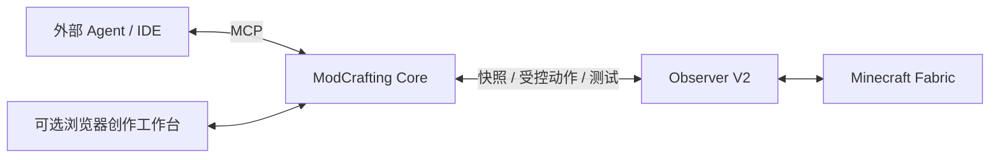

# ModCrafting

**与 Agent 一起，把创作想法变成 Minecraft 模组。**

ModCrafting 是面向外部 AI Agent 的 **Minecraft Fabric 开发 Core/MCP 工具与可视化创作工作台**。Agent 负责对话、规划和代码编辑；你可以在浏览器调整配方、内容属性和 MC 界面，写回同一工程，再构建并进入游戏验证。

项目已从 Electron Desktop 主入口迁移到独立 Core/MCP，提供 **22 个 MCP 工具、两份 Skill 和可选浏览器界面**。模型与账户由宿主管理，ModCrafting 无需另配模型 API Key。当前独立产品以源码构建和本地候选包交付；GitHub Releases 中的旧 Desktop 安装包属于历史产品。

## 可以做什么

| 能力 | 当前支持 |
|---|---|
| 配方创作 | 有序合成 3×3 拖放、无序合成、熔炉、高炉、切石机；材料搜索、产物数量、预览与保存 |
| 内容参数 | 物品、食物、方块、生物、工具、护甲的适用参数、范围校验与资源关联 |
| MC 界面创作 | Screen、配置页面、HUD；文字、面板、按钮、开关、整数滑块、展示槽位；拖拽、尺寸、吸附、绑定与交互模拟 |
| 素材预览 | 原版/工程物品与纹理；从本机 1.21.4 客户端准备私有缓存，优先工程资源 |
| Agent 协作 | Web 与 MCP 读写同一工程；变更预览、确认应用、版本冲突保护，Agent 可继续读取已保存内容 |
| 工程与知识 | Fabric 工程检查/创建、固定 Wrapper、标准 ID/属性查询、离线文档与 Wiki 关键词搜索 |
| 构建与游戏 | Gradle 异步任务、日志、隔离游戏实例、Observer V2 快照、动作与三态测试报告 |

受支持的声明式内容可以编辑；未知或被外部修改的生成 Java 保持只读，交给 Agent 合并。保存工程后需重新构建/启动游戏，网页模拟与游戏真实状态分别验证。

## 工作方式



典型流程：**描述想法 → Agent 创建草稿 → 浏览器调整 → 预览并确认写回 → Agent 接续 → 构建 → 游戏验证**。

浏览器与 MCP 可由同一后端提供。关闭页面后已提交任务继续运行；退出其所属后端/宿主连接会结束该进程拥有的任务。独立启动的两个后端共享工程文件，各自管理运行任务。

## 快速开始

当前支持 **Windows x64 / Fabric 1.21.4**。准备 Node.js **22.15+ 或 24**、pnpm **10.34.7**；执行模组构建和游戏运行时还需系统 **JDK 21** 与工程 Gradle Wrapper。已有工程需自带 Wrapper，MCP 新建工程附固定 Gradle 9.5.0 Wrapper。

### 从源码打开工作台

在仓库根目录执行：

```powershell
pnpm install --frozen-lockfile --ignore-scripts
pnpm run build
$env:MODCRAFTING_DATA = 'D:\ModCraftingData\core'
pnpm start
```

打开终端打印的完整本机链接，输入 Fabric 1.21.4 工程的绝对路径。`pnpm run build` 构建独立 MCP、Bench 和迁移命令，不编译 Java、不启动游戏。源码仓保留旧 Desktop 开发依赖，`--ignore-scripts` 避免其生命周期下载；独立交付包无需 Electron、源码或 node_modules。

多个 Worktree **共享 pnpm Store，各自保留独立 node_modules**。设置 Store 时使用适合自己的磁盘位置，详见 [pnpm 迁移记录](docs/phase-00-pnpm-report.md)。

### 接入 Agent

通过宿主连接 `plugins/modcrafting-fabric/dist/mcp-server.js` 的 stdio MCP，并按需安装两份 Skill。启用 `--web` 后，调用 `modcrafting_environment_status` 获取 `browserUrl`，页面与该 MCP 会话使用同一后端。默认 MCP 不开启 HTTP；`--web-only` 提供独立浏览器服务。

安装与配置见 [Codex App / Qoder 桌面接入](docs/desktop-host-quickstart.md) 和 [Codex / Claude / Qoder 分发](docs/host-distribution.md)。先提供工程路径，让 Agent 调用环境与工程检查，再按需求执行创作、构建和游戏操作。完整浏览器用法见 [工作台指南](docs/browser-view.md)。

### 构建可复制的完整产品包

```powershell
# 改为本机实际 JDK 21 安装目录
$env:JAVA_HOME = 'C:\Program Files\Java\jdk-21'
$env:PATH = "$env:JAVA_HOME\bin;$env:PATH"
pnpm run candidate:build
```

该命令从当前源码构建 MCP、Bench、迁移命令和 Observer V2，组装完整产品与三宿主分发，输出路径记录在 `temp/candidate-artifacts/run-*/candidate.json`。首次 Wrapper/依赖解析可能联网；既有缓存的离线构建条件见 [候选指南](docs/candidate-validation.md)。

在生成的产品根目录，也可直接运行：

```powershell
$env:MODCRAFTING_DATA = 'D:\ModCraftingData\core'
node ./plugin/dist/mcp-server.js --web-only
```

## 游戏验证与当前边界

游戏操作需要 JDK 21、工程 Wrapper、独立游戏目录和 Observer V2。**当前公开 base-mods 包仍含 V1**：资源准备后，按 [产品交接](docs/product-handoff.md) 将完整产品包的 V2 应用到自己的缓存，再检查运行时 `bridgeReady`。资源已存在不代表协议兼容。

自动测试只在专用 **ModCrafting Test World** 执行。报告分别保留 **PASS / FAIL / INCONCLUSIVE** 和清理结果；截图只作辅助展示。HUD 的原生绘制/显隐观察与自动断言分别记录，现有自动 HUD 断言仍有能力限制。

| 范围 | 状态 |
|---|---|
| Codex | 真实配置的原生 App Server 已加载两份 Skill、22 工具并读回布局；既有聊天需重连后确认新版 |
| Claude Code | 历史原生安装/工具调用已验证；新版 22 工具分发通过 SDK/配置 Smoke，不扩大为新版聊天实测 |
| Qoder 桌面 / CLI | 桌面历史只读调用已通过；新版创作聊天待复验，隔离 CLI 登录项保留 |
| GUI / HUD | 基础 Screen、配置页面和 HUD 已实机验证；展示槽位不执行服务端容器交换，文本输入/循环控件与自由脚本未实现 |
| 后续能力 | 聊天内嵌 MCP Apps、3D 模型编辑、游戏内建筑生成与 AI 整合包创作尚未交付 |

贴图预览目前为静态图或纹理展开图；特殊渲染物品可能保留文字标识，不能当作完整 3D 效果。完整支持范围与后续顺序见 [创作需求](specs/creator-workbench/requirements.md) 和 [转型路线](docs/transformation-roadmap.md)。

## 开发与验证

```powershell
pnpm run dev           # 重建 MCP 并启动工作台；源码变更后重新运行
pnpm run typecheck     # Core/MCP 与浏览器类型检查
pnpm test              # Core、创作、浏览器、分发与迁移回归
pnpm run plugin:stage  # 白名单独立插件包
pnpm run plugin:smoke  # 仓库外真实 MCP 协议检查
pnpm run bench:fabric  # Fixture 三态/错误矩阵，不启动 Minecraft
```

[整体重构 PR #2](https://github.com/newstarbar/ModCrafting/pull/2) 已合并。对应基线完成 Git 导出源码复建、共享 Store 零下载安装、**103/103 回归**、22 工具协议 Smoke、三宿主 SDK/配置 Smoke，GitHub Windows / Node 22 [main CI 已通过](https://github.com/newstarbar/ModCrafting/actions/runs/38894739652)。CI 不运行真实 Minecraft；实机证据分别见 [配方](docs/archive/2026-10-15-recipe-creator-workbench.md)、[内容参数](docs/archive/2026-10-16-content-parameter-workbench.md)、[MC 界面](docs/archive/2026-10-16-mc-gui-workbench.md)。

## 从旧 Desktop 迁移

按 [迁移与功能替代清单](docs/desktop-retirement.md) 对明确的旧配置目录做只读盘点，再显式导入到全新 Core 数据根。仅迁移工程路径引用；原工程、依赖、密钥、聊天、存档和缓存保留原地。迁移工具不会卸载旧应用或删除用户数据。

旧 Electron 源码与 `desktop:*` / `build:win*` 兼容命令保留，退出默认入口；标签推送不再自动发布 Desktop。完整创作替代仍按支持范围逐项推进，历史说明见 [Legacy Desktop](docs/legacy-desktop.md)。

## 文档与许可

[架构](docs/architecture.md) · [Core 契约](docs/core-contracts.md) · [命令](docs/commands.md) · [Fabric-Bench](docs/fabric-bench.md) · [文档索引](docs/README.md)

GPL-3.0；Observer MIT，分发包附各依赖许可。ModCrafting 与 Mojang / Microsoft 无官方关联；不含 Minecraft 游戏本体，使用游戏需遵守其 EULA。
