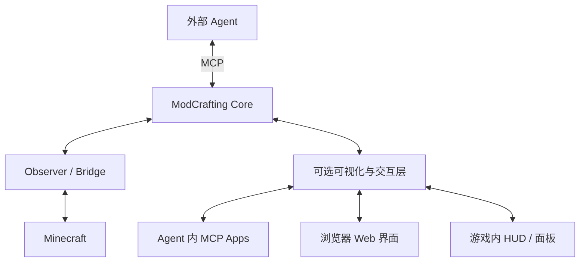

# ModCrafting 转型路线与阶段进度

修订：2026-10-15。**当前阶段规划以本文件为准**；旧 phase 文档保留任务来源与历史验收记录。用户最新方向是 Core/MCP 独立产品、可选可视化替代 Desktop，并在替代能力成熟后退役旧 Desktop。

本轮产品范围纠正：用户要求迁移 Desktop 的 Minecraft 专属创作交互，包括配方、内容参数和 MC UI，并规划 3D 模型、游戏内建筑生成及 AI 整合包创作。当前 Web 已补首轮配方与 R3 六类内容参数创作闭环（预览/保存、Agent 读回与真实游戏验证），不能据此宣称全部创作替代完成。R4 基础 Screen/配置页面/HUD 已完成首轮闭环，后续按[创作工作台需求](../specs/creator-workbench/requirements.md)补齐复杂容器及其余能力；不新增 P 编号。已有验收记录保留。

最新配方交付与宿主边界见[配方归档](./archive/2026-10-15-recipe-creator-workbench.md)。R4 当前 22 工具；Codex 真实配置原生布局调用已验证，Qoder 新候选已更新配置，聊天调用需重连后复验。详见[界面归档](./archive/2026-10-16-mc-gui-workbench.md)。

## 产品目标与边界

外部 Agent 负责对话、规划和代码编辑；ModCrafting Core 提供 Fabric 项目、知识、资源、构建、游戏运行与可信验收；MCP 是宿主适配入口。Core 不接入模型 API、不实现另一套 Agent Loop。

Core 与 Minecraft 之间保留可选的展示与交互能力，支持 Agent 内、浏览器或游戏内入口。展示入口共用 Core 的数据与操作契约；关闭全部界面后，构建和测试仍能运行。

Agent 内与浏览器入口尽量复用 Web 视图；游戏内原生界面复用数据和操作协议。MCP Apps 的展示依赖宿主扩展支持，普通 MCP 连接成功不能证明 UI 可用；目标宿主需实测，不支持时提供浏览器入口。[官方说明](https://modelcontextprotocol.io/extensions/apps/overview)

Desktop 进入过渡兼容期，冻结功能扩张。旧代码作为迁移参考；新增能力与验收主线落在独立 Core/MCP 和替代入口。

## 阶段总表

| 阶段 | 目标 | 当前状态 | 退出条件 |
|---|---|---|---|
| P0 安全与依赖基础 | Git 隔离、pnpm 共享 Store、各 Worktree 独立依赖 | 已本地验收；合并旧 P0 与 P0.5 的进度登记 | 原 main 与用户文件保留，独立 node_modules、依赖/构建基线可追溯 |
| P1 独立 MCP 底座 | Stage、真实协议、Codex 入口、能力诊断与安全验收 | 已本地验收；未发布，远端 CI 未执行 | 插件可脱离 Electron/源码启动，真实工具调用与本地 Codex 入口可验证 |
| **P2 独立 Core 与 Bench 收口** | 清理主线依赖、稳定契约、可移植实机基准 | **已本地验收；P2-01～04 完成，未发布/远端 CI 未执行** | 独立入口完成开发/测试闭环，Bench 可复现且不依赖旧 Desktop 或历史临时工程 |
| **P3 可选可视化替代层** | Agent / 浏览器 / 游戏内的创作、执行与验收交互 | **执行型浏览器、首轮配方、R3 参数及 R4 基础 MC UI 已本地验收；复杂容器与其余创作能力待完成** | 创作对象能编辑、写回、Agent 接续及实机验证；关闭 UI 不影响已提交任务 |
| **P4 跨 Agent 分发** | Codex、Claude、Qoder 首批安装与能力适配 | **分发开发完成；真实 Qoder 桌面只读调用已通过，Codex 新版当前桌面对话需刷新；隔离 Qoder CLI 登录项仍保留** | 每个平台独立验证安装、连接、工具调用；UI 支持与备用入口如实记录 |
| P5 Desktop 退役 | 完成核心功能替代、数据迁移与旧入口退出 | 路径迁移、默认入口和旧自动发布退出已本地验收；**完整创作功能替代未完成**，源码/数据保留 | 逐项完成旧创作能力替代和用户数据保留验证，再决定进一步退役操作 |

基础实施按 **P2 → P3 → P4 → P5** 推进，P2 与 P3 的执行入口、P4 分发开发和 P5 入口/数据迁移已有本地成果。本轮补齐 P3 创作迁移需求，完整功能替代保持未完成；不重做已通过的 Core/Bench。多 MC 版本、其他 OS、线上榜单和游戏内 AI 陪伴不作为当前门槛。

“已本地验收”不等于已提交、已发布或远端 CI 通过。规划完成也不等于后续业务任务完成。

真实桌面接入的新结果见[接入记录](./archive/2026-10-15-real-desktop-host-integration.md)，不能以隔离 CLI 待登录状态覆盖真实 Qoder 桌面结果。

## 重构后的候选收口

用户授权后的本地候选已固化为源码提交 74e8504；Git 导出的独立源码使用共享 Store、独立 node_modules 完成完整构建与 82/82 回归。新建工程附带固定 Wrapper，完整包从当前 Observer 源码组装；真实兑换物品完成 2 PASS / 2 FAIL 和缺失实例 INCONCLUSIVE，清理完整，JAR 已导出。没有新增 P 编号。详见 [候选验收报告](./candidate-validation-report.md)。隔离 Qoder CLI 登录项、外部用户试用、远端 CI 和发布继续单列；真实 Qoder 桌面只读调用已通过，不代表创作 UI 已迁移。

## 已有成果如何归入新计划

| 原工作 | 处理 | 依据 / 证据 |
|---|---|---|
| 旧 P0 Git 安全、旧 P0.5 pnpm / EXE 启动修复 | 归入 P0，保留，避免重做 | [Git 报告](./phase-00-git-report.md)、[pnpm 报告](./phase-00-pnpm-report.md)；正式安装器生命周期未验证，属于旧产品事项 |
| P1 独立 Stage、SDK Smoke、Codex 安装与真实构建/游戏闭环 | 归入 P1，继续复用 | [P1 报告](./phase-01-implementation-report.md)、[宿主验收](./phase-01-live-acceptance-report.md)；报告中的桌面重启/插件界面指 Codex 宿主 |
| Core GameTest、三态结果、统一摘要、标签能力门控 | 归入 P2，保留 | packages/modcrafting-core 与 [原 P2 实施记录](./phase-02-implementation-report.md) |
| 离线 Bench、实机案例和运行证据 | 归入 P2，P2-03 已固化可移植 CLI，P2-04 完成完整本地交接 | 历史 21/21、10/10 保留；新 MCP 冷资源/实机 10/10、独立 CLI 3/3 见当前报告 |
| Desktop 摘要接入、session 清理/快照扩展、相关测试/CI 耦合 | P2-01 已逐段审阅；额外接入已移出，安全修复保留，测试/CI 已解耦 | [P2 当前报告](./phase-02-core-report.md)；没有整文件回退或覆盖 P1 |
| Desktop 全断言迁移、旧前台 E2E、旧安装器完整生命周期 | 移出转型交付门槛 | 不再将这些事项写成 P2 未完成的必修项；兼容期有明确缺陷时单独处理 |

P2-02 验证快照：Node 22/24 独立回归各 54/54，无 Desktop/Electron、仅 Zod 的副本同样通过；离线 21/21、Stage/真实 SDK 协议验证通过，工具仍为 19 个。全仓 818/797/21，23 条旧类型错误逐项一致。历史实机 10/10（5 PASS、3 FAIL、2 INCONCLUSIVE）保留，本轮没有重跑游戏。契约见 [Core 接口](./core-contracts.md)，证据见 [当前报告](./phase-02-core-report.md)。

P2-03 最新验证：独立 live CLI 与自包含双模式 Bench 包完成。无 Desktop/Electron、仅 Zod 的副本 Node 22/24 各 64/64；仓库外 fixture 各 21/21、最终实机 10/10 匹配（5 PASS / 3 FAIL / 2 INCONCLUSIVE），输入来源保持且本轮进程全部结束。全仓 828/807/21、23 条旧类型错误逐项不变。使用已准备 Observer 与预热缓存，首次真实资源准备及完整交接仍留在 P2-04。命令见 [Bench 指南](./fabric-bench.md)，本轮证据见 [当前报告](./phase-02-core-report.md)。

P2-04 验证：冷根下载五个真实 Release 包并核对发布 digest，修复文档 limit 越界；公开 Observer V1 不兼容，由源码构建且随完整本地产品提供 V2（准备后需显式覆盖自己缓存，远端未升级）。Node 22/24 独立回归 65/65、SDK Smoke 19 工具；MCP 构建/实机 10/10，独立 live CLI 三态 3/3；全仓 829/808/21、23 条旧类型错误不变。来源保留、17 作业收敛及相关进程剩余 0；交接见 [产品说明](./product-handoff.md)。P2 本地完成，未发布/远端 CI 未运行。

P3 最新验证：首发浏览器覆盖工程/环境/构建/隔离游戏/场景/报告，MCP 与 UI 共用 runtime。Node 22/24 独立及仓库外仅 Zod 回归各 68/68，协议仍 19 工具；真实 UI 三态 1 PASS / 1 FAIL / 1 INCONCLUSIVE，关闭全部页面后有效 MCP 场景继续 PASS、构建 exitCode 0。报告下载与 390px 布局验证通过，六任务收敛、相关进程剩余 0。全仓 832/811/21 与 23 类型错误保持旧基线，未发布。见 [P3 报告](./phase-03-visualization-report.md) 与 [浏览器指南](./browser-view.md)。

P4 最新验证：生成不同宿主清单及不覆盖的 TOML/JSON 配置，Core bundle 与 P3 完全相同。Codex 原生/App Server 与 Claude Code（本地 Provider 回放，0 真实模型调用）完成安装、两份 Skill、19 工具与实际调用；原生配置备用及 --web API 通过。Qoder 原生安装/两份 Skill/19 工具连接通过，未登录实际调用待验收。三宿主隔离副本禁用后缓存/数据保留；Node 22/24 回归各 73/73，SDK/config 三入口通过；全仓 837/816/21 与 23 旧类型错误不变。详见 [P4 报告](./phase-04-distribution-report.md) 与 [分发指南](./host-distribution.md)。

## P2 执行清单

### P2-01：整理交付范围与遗留耦合

- [x] 建立统一阶段表、已有成果映射和新验收边界，修正文档入口。
- [x] 以已保存的 P1 清单/patch 和原文备份逐段审阅混合 diff；保留主线与兼容安全修复，移出额外 Desktop 接入。原文和分类记录保存在本轮独立证据目录。
- [x] 拆分 Core/Bench 回归与 Desktop 专用回归；插件 CI 移除 Desktop 路径。plugin:test 增加模块导入守卫，并在无 Desktop/Electron 的副本中通过验证。

完成标准：新产品代码、构建与定向测试能独立于 src/renderer、Electron 和旧 Harness；没有因整理而丢失 P0/P1 变更或用户文件。

### P2-02：稳定 Core 的业务与展示契约

- [x] 核对项目、资源、构建任务、游戏实例、场景、证据和产物接口；抽出纯数据契约，环境响应增加资源诊断与 Core 能力声明。
- [x] 构建/实例/动作/快照/测试与报告调用迁入 FabricRuntime；MCP 保留原 19 个工具名、描述和输入 Schema，作为薄适配。
- [x] 用冷数据根和受控下载夹具确认解包/消费路径、代理回退和失败诊断；系统工具链仍需显式提供，首次真实远端资源准备留待 P2-04。
- [x] 明确 P3 的任务/日志、实例/桥、截图/报告和必要操作契约，以及状态所有者和能力限制；见 [Core 契约](./core-contracts.md)。

完成标准：外部调用者能用现有 Core/MCP 能力推进任务并读取结果；能力缺失、失败、取消和清理状态机器可读。沿用已有 Schema 与 API，仅补闭环缺口，不以复刻旧 Desktop 全部断言为目标。

### P2-03：将实机 Bench 固化为可移植工具

- [x] 保留离线 CLI 的明确 fixture 模式；将已验证的实机流程整理为独立 live 运行命令，输入项目、运行目录、工具链和案例集。
- [x] 使用配置/标准环境诊断替代固定个人 JDK 路径、P1 临时工程、旧 run 目录及私有 Codex 验收驱动依赖。
- [x] 两种模式共用 Core 执行器与报告，保存案例/源码或执行包指纹；预期匹配数与实际三态数量分别报告。
- [x] 实机运行限定独立工程、gameDirectory 与专用测试世界；结束本轮进程并保留清理/失败证据。CI 默认运行离线协议/夹具，不自动启动 MC。

完成标准：另一开发者只需提供文档声明的环境与输入就可复现，不依赖维护者机器上的历史目录。

### P2-04：独立产品验收与交接

- [x] 在仓库外的交付目录，从环境诊断、项目检查、按需资源到构建、专用世界测试、报告完成一次闭环；证明无 Electron 和源码解析依赖。
- [x] 运行受影响的类型检查、Core/插件回归、协议 Smoke、离线 Bench 与代表性实机用例；记录 fixture/live、能力限制和未验证项。
- [x] 更新 P2 状态与证据、交付命令和 P3 所需契约，达到退出条件后进入 P3。

既存全仓红色基线单列，不强制修复所有旧 Harness 问题；远端 Actions 需在获授权的远端操作后实测，不能用本地结果代替。

## P3：可选可视化替代层

范围更新：下列步骤和已通过的退出条件属于首发执行工作台。完整替代还需完成[创作需求 R1～R4](../specs/creator-workbench/requirements.md)的对象目录、配方、参数、MC UI 交互与写回/游戏验收；R5～R7 登记 3D、建筑和整合包后续主线。首轮配方已补实现和新实机证据，R3 六类内容参数已完成，R4 MC UI 尚未开始；不将旧结果改写为通过。

1. 列出最小用户流程：打开项目 → 查看环境 → 构建 → 启动/停止 MC → 测试 → 查看证据与报告。
2. 先核实目标宿主 MCP Apps 支持与实现成本，再选一个首发入口。浏览器提供独立可用的入口；宿主支持时复用 Web 视图嵌入 Agent。此规划不宣称 Codex 等宿主已经支持交互展示。
3. 首个界面复用项目已有 React/组件和成熟 MCP Apps 能力，通过最薄的适配连接 Core。只迁移展示组件，剥离 window.api 和旧 Harness 依赖。
4. 游戏内 HUD/面板按需接同一数据/操作协议；UI 接入本身不包含另建 AI 陪伴 Mod。

退出条件：至少一个可选入口能完成上述流程，状态与 Core 一致，失败/能力不足能正确展示；关闭全部 UI 后同一构建/验收仍可通过 MCP/CLI 执行。三入口全部上线不作为首批 MVP 要求。

执行入口的本地验收已通过：浏览器首发与 MCP 同一 runtime、真实构建和四个有效/限制场景、报告下载、桌面/窄屏截图及 UI 关闭后继续执行均有证据。首轮配方已完成独立验收：实际合成 2 PASS / 2 FAIL、清理完整，R3 六类参数另完成 9 PASS / 3 预期 FAIL 与补验 3 PASS，MC UI 尚未迁移。默认 MCP 不启用 HTTP；显式 --web 或 --web-only 启动，Stage 仍九文件。MCP Apps 与游戏内新界面未上线；资源 V1→V2 显式兼容步骤仍保留。

## P4：跨 Agent 安装与分发

以同一 Core/MCP 交付包适配 Codex、Claude、Qoder；复用 P1 的 Codex 安装证据，但新包仍需对应验证。逐个平台核对官方安装机制与许可/依赖，提供安装、升级、禁用及保留数据的说明。分别记录 MCP 工具与 MCP Apps 的支持，提供浏览器备用入口，不假定各客户端共用清单格式。

退出条件：首批平台各有独立安装、连接和工具调用证据；可视化能力与回退方式明确。向 GitHub/npm 等发布仍依照用户授权执行。

分发验收保留不同清单、相同 bundle/Skills/许可、配置生成、Codex/Claude 实际调用、浏览器备用和三宿主禁用保留数据。隔离 Qoder CLI 未登录的调用项仍保留；后续真实 Qoder 桌面安装/只读调用已通过，Codex 新版配置调用通过而当前桌面对话需刷新，详见接入记录。MCP Apps 嵌入与远端发布仍未完成，不扩大为新 P 编号。

## P5：Desktop 退役条件

范围纠正：原表漏列的内容模板/参数表单、合成网格、内容预览和 GUI 布局交互必须进入替代清单。不能统一以“宿主编辑源码”替代用户所需的可视化创作；具体复用证据与验收见[创作需求](../specs/creator-workbench/requirements.md)。

| 旧 Desktop 能力 | 替代去向 |
|---|---|
| AI 对话、计划、模型配置、代码编辑 | 宿主 Agent / IDE |
| 工程与运行目录、工具链和知识资源管理 | Core/MCP + 可选界面 |
| 构建、任务日志、游戏启动/停止 | Core 任务能力 + 可选界面 |
| 游戏观察、测试、截图、证据与报告 | Core + Observer + 可选界面 |
| Desktop 本地配置、项目路径和已有数据 | 明确迁移/保留规则，先验证 readback 与路径可用性 |

先建立功能替代清单与迁移验证，再停止将 Desktop 作为新用户主入口，最后处理旧 Electron 构建/发布/源码的退出。不得直接删除用户数据；可视化方案确定不等于现在已具备退役条件。

P5 的入口/数据迁移本地验证通过：独立工程路径迁移、Agent/浏览器读回、关闭 UI 后真实 Gradle 构建、默认 Node 入口及旧 tag 自动发布退出均有证据。完整创作替代未完成，旧源码/开发依赖和用户原数据保留，不执行物理清理。历史实施与边界见 [P5 报告](./phase-05-retirement-report.md)。

## 进度与安全规则

- 只维护本阶段表的一份当前状态；阶段报告记录具体结果，旧文档顶部注明历史身份。不要把“首批”“补验”扩成新的 P 编号。
- 当前产品完成度以上表和创作需求为准；后续实现先交付可见、可编辑、可写回的最小业务闭环，不以执行/入口验收替代创作验收。
- 新任务说明所属阶段、交付物与退出条件；P2 保留通过结果，P3 补齐创作迁移，P4 按真实宿主分别记录；P5 保留已实施的入口切换，完整功能替代待创作验收，数据规则见 [退役指南](./desktop-retirement.md)。
- 历史 P0.5 的名称与报告保留，进度归入 P0；不修改过去的验收数字，也不将本地安装/宿主 UI 与 ModCrafting Desktop 混为一谈。
- 修改继续位于隔离 Worktree；原 main、用户未跟踪文件和历史证据保持。共享 pnpm Store，各 Worktree 独立 node_modules。
- 重规划本身只修改规划与指引；用户随后授权实施，P2-01 已逐段处理源码。提交、推送、发布、删除数据或升级真实账户插件仍按既有授权边界执行。

原始依据：[P1 转型任务书](./phase-01-mcp-foundation.md) 的目标架构与阶段建议，以及用户本轮明确的可选展示层、Desktop 后续弃用和重新规划要求。可视化提前单列 P3 是本次重排的决定，原先“Installer 后再可视化”的顺序保留在历史任务书中。

R3 当前实现/限制与证据见[内容参数归档](./archive/2026-10-16-content-parameter-workbench.md)。P5 完整创作替代继续保持未完成，R4 基础 MC UI 证据见[界面归档](./archive/2026-10-16-mc-gui-workbench.md)，后续为 R5/R6 成熟工具与边界评估，R7 独立主线。
